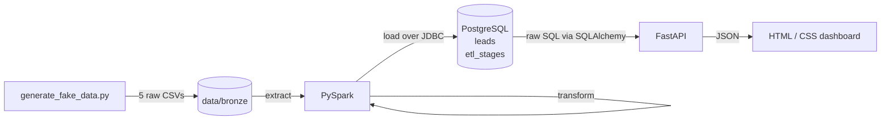

# Marketing Engine

An end-to-end ETL pipeline that turns messy B2B lead lists into a clean, queryable PostgreSQL table, with a live HTML/CSS dashboard on top.

Five raw CSV exports with inconsistent schemas are extracted, cleaned and validated with **PySpark**, loaded into **PostgreSQL** over JDBC, and explored through a **FastAPI** dashboard that runs raw SQL through **SQLAlchemy**.


## Pipeline



### Extract
`etl/generate_fake_data.py` writes five lead lists to `data/bronze/`. They copy the shape of real data-broker exports, including the inconsistencies:

| File | Columns | Quirks |
|---|---|---|
| `table_1`, `table_4` | `URN, CompanyregNo, Company, Ad1–Ad4, Town, County, …, Email, …, Emps, TO` | capitalised `Email` |
| `table_2`, `table_5` | same as above | lowercase `email` |
| `table_3` | `ID, CompanyName, Address1–Address6, TelephoneNumber, Firstname, Surname, Role, …, EmployeeBand, TurnoverBand` | different naming throughout, no town/county or TPS columns |

The generated rows contain missing contact details, malformed emails, phone numbers in several formats (`01134960123`, `0113 496 0123`, `+44 113 4960123`), websites with and without `http(s)://`, stray whitespace and capitals, exact duplicate rows, and the same contact appearing in more than one file. All phone numbers come from Ofcom's ranges reserved for fiction.

### Transform (PySpark)
`etl/pipeline.py`:

1. **Harmonise schemas.** Renames `table_3`'s columns to the common naming, then unions all five files by column name and tags each row with `source_table`.
2. **Filter.** Keeps only SIC sector G (wholesale & retail trade).
3. **Clean & standardise.**
   - Trims every text field and lowercases emails.
   - Strips `http(s)://` and trailing slashes from websites.
   - Converts phone numbers to 11-digit UK format (`+44` becomes `0`).
   - Upper-cases postcodes and derives the postcode area.
   - Parses incorporation dates.
4. **Validate.** Nulls out emails, websites and phone numbers that fail format checks, then drops any lead without a usable email, phone and website.
5. **Flag compliance.** `tps_registered` is true when the number is on the TPS or Corporate TPS list.
6. **Deduplicate.** One row per email address, across all source files.

The row count after each stage is recorded.

### Load (PostgreSQL)
The pipeline creates the database if it doesn't exist, then:

- writes the result to `leads` through Spark's JDBC writer
- adds a primary key on `email`
- records the stage counts in `etl_stages`, which the dashboard shows as a funnel

### Dashboard
`dashboard/app.py` is a small FastAPI app. Every chart is a raw SQL query executed with SQLAlchemy's `text()`. Each card can be re-run, and has a toggle showing the exact SQL behind it. The charts are plain HTML/CSS bars with no charting library.

The **SQL console** at the bottom runs your own queries against the database. It is restricted to one `SELECT`/`WITH` statement per run, inside a read-only transaction, with a 5-second statement timeout and a 500-row cap.

| Endpoint | Description |
|---|---|
| `GET /` | Dashboard |
| `GET /api/queries` | Saved queries with their SQL |
| `GET /api/queries/{key}` | Run a saved query |
| `POST /api/sql` | Run a read-only query: `{"sql": "SELECT ..."}` |

## Running it

**Requirements:** Python 3.10+, Java 17+ (for Spark), and a local PostgreSQL server.

```powershell
python -m venv venv
venv\Scripts\activate
pip install -r requirements.txt

$env:DATABASE_URL = "postgresql+psycopg://postgres:<your-password>@localhost:5432/marketing_engine"

python etl/generate_fake_data.py
python etl/pipeline.py
python dashboard/app.py
```

Then open http://127.0.0.1:8000.

On macOS/Linux, use `source venv/bin/activate` and `export DATABASE_URL=...` instead. If your password contains special characters, URL-encode them (for example `@` becomes `%40`).

The first pipeline run downloads the PostgreSQL JDBC driver from Maven Central into `jars/`. Spark loads it from the driver classpath, so the pipeline also runs on Windows without `winutils.exe`. The `HADOOP_HOME` warning Spark prints at startup can be ignored.

Example output:

```
extracted                  27040
wholesale_retail_only      10945
valid_contact_details       6750
deduplicated                6095
Loaded 6095 leads into marketing_engine.leads
```

## Project layout

```
etl/
  generate_fake_data.py   builds the five raw CSVs
  pipeline.py             extract → transform → load
dashboard/
  app.py                  FastAPI + SQLAlchemy raw SQL API
  static/                 index.html, style.css, app.js
docs/
  dashboard.png
```

## Tech stack

PySpark · PostgreSQL · SQLAlchemy · psycopg 3 · FastAPI · Uvicorn · HTML · CSS · vanilla JavaScript
