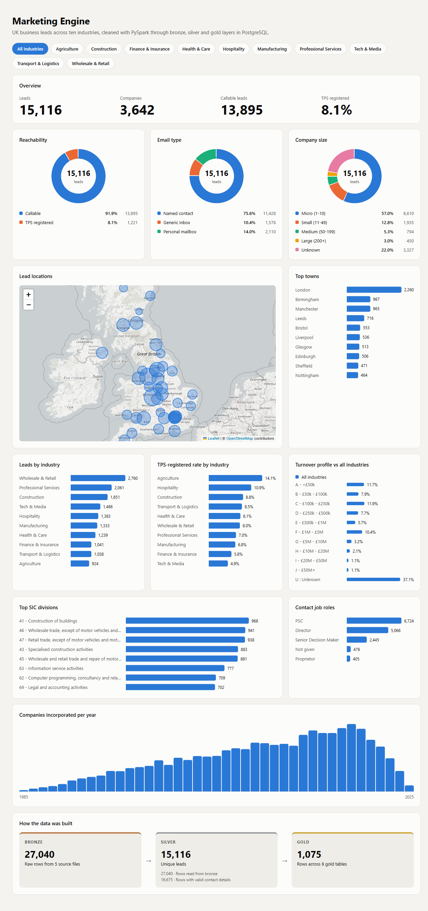
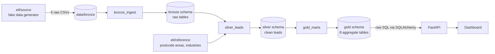
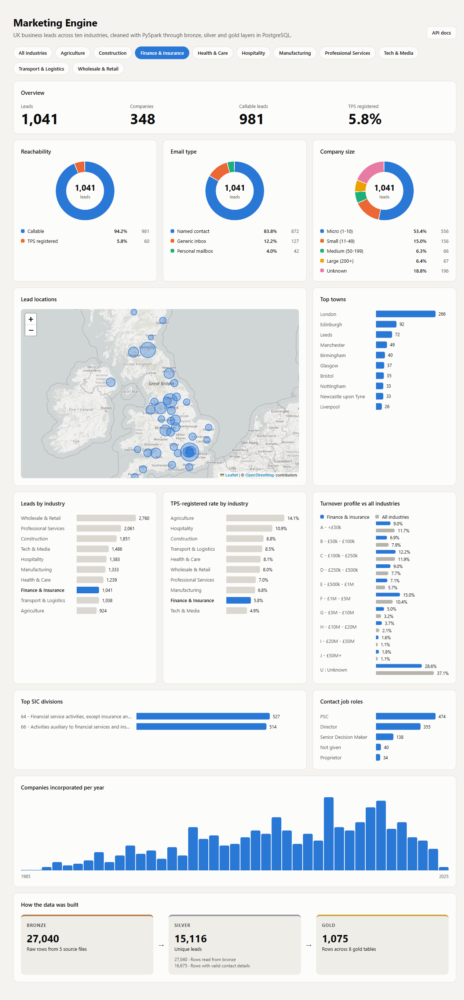

# Marketing Engine

An end-to-end ETL pipeline that turns messy B2B lead lists into analytics-ready tables, with a live dashboard you can filter by industry.

Five raw CSV exports with inconsistent schemas are processed by **PySpark** through a **bronze → silver → gold** medallion architecture in **PostgreSQL**. A **FastAPI** dashboard then reads the gold layer with raw SQL through **SQLAlchemy**, and renders it with HTML, CSS and a Leaflet map.



## Architecture



Each layer is its own PostgreSQL schema, and each job reads only from the layer before it. Any job can be re-run on its own without starting the whole pipeline again.

| Layer | Contents | Job |
|---|---|---|
| **bronze** | The five source files, loaded exactly as received (every column as text) plus `_source_file` and `_ingested_at` | `etl/jobs/bronze_ingest.py` |
| **silver** | `silver.leads`: one validated, standardised, enriched and de-duplicated row per contact, with `email` as the primary key | `etl/jobs/silver_leads.py` |
| **gold** | Pre-aggregated tables split by industry, built for the dashboard | `etl/jobs/gold_marts.py` |

Every job writes its row counts to `public.etl_stages`, so each run leaves an audit trail.

## The data

`etl/source/generate_fake_data.py` creates five lead lists in `data/bronze/` covering **ten industries** (SIC sections A, C, F, G, H, I, J, K, M and Q), with real SIC 2007 division and class codes. The industry definitions live in `etl/source/catalog.py`.

Each industry has its own profile, so the filters show real differences:

- **Location:** Finance clusters in the City of London and Edinburgh, Agriculture in Norfolk, Devon and the Highlands, Manufacturing in the Midlands.
- **Company size and turnover:** the mix of size and turnover bands differs between industries.
- **Contact data:** TPS registration rates and the share of personal (e.g. Gmail) addresses differ.

The files reproduce the quirks of real data-broker exports:

| File | Schema | Quirks |
|---|---|---|
| `table_1`, `table_4` | `URN, CompanyregNo, Company, Ad1–Ad4, Town, County, …, Email, …, Emps, TO` | capitalised `Email` |
| `table_2`, `table_5` | same | lowercase `email` |
| `table_3` | `ID, CompanyName, Address1–Address6, TelephoneNumber, Firstname, Surname, Role, …, EmployeeBand, TurnoverBand` | different naming, no town, county or TPS columns |

The rows also include:

- missing contact details and malformed emails
- phone numbers in three formats (`01134960123`, `0113 496 0123`, `+44 113 4960123`)
- websites with and without `http(s)://`
- stray whitespace and capitals
- exact duplicate rows, and the same contact repeated across files

All phone numbers come from Ofcom's ranges reserved for fiction.

## Transformations

Column rules live in `etl/transforms/columns.py`, row-level steps in `etl/transforms/leads.py`, and aggregations in `etl/transforms/marts.py`. They are pure DataFrame functions with no I/O, so each one can be tested on its own.

1. **Harmonise:** rename `table_3`'s columns to the common schema, then union all files by column name.
2. **Standardise:**
   - Trim text and lowercase emails.
   - Convert phone numbers to 11-digit UK format (`+44` becomes `0`).
   - Strip `http(s)://` from websites.
   - Normalise postcodes and parse dates.
3. **Derive:**
   - SIC sector code and postcode area.
   - Company size class from the employee band.
   - Email type: named contact, generic inbox or personal mailbox.
   - TPS/CTPS flag.
4. **Enrich:** join reference data from `etl/reference/` for readable industry names, map coordinates, and the town and county missing from `table_3`.
5. **Validate:** null out invalid emails, phones and websites, then drop leads that can't be contacted on all three.
6. **De-duplicate:** keep one row per email address across all sources.
7. **Aggregate (gold):** industry summary, locations, email mix, company size mix, turnover mix, SIC divisions, job roles and incorporations by year.

## Dashboard



The industry buttons filter the whole dashboard. Every chart is a raw SQL query against the gold schema, run through SQLAlchemy `text()` with a bound `:industry` parameter.

- **Overview:** leads, companies, callable leads and TPS-registered rate.
- **Donut charts:** reachability, email type and company size, drawn in pure CSS with `conic-gradient`.
- **Map:** lead locations as bubbles sized by volume (Leaflet + OpenStreetMap).
- **Comparisons:**
  - Leads and TPS rate for every industry, with the selected one highlighted.
  - The selected industry's turnover profile against all industries.
- **Breakdowns:** top towns, SIC divisions, contact roles, and companies incorporated per year.
- **Pipeline:** row counts through bronze, silver and gold, from `public.etl_stages`.

The API is a single read-only endpoint: `GET /api/dashboard?industry=K` (or `ALL`). It validates the filter, then runs every query in one read-only transaction with a statement timeout.

## Running it

### 1. Install the prerequisites

| Tool | Version | Download |
|---|---|---|
| Python | 3.10 or newer | https://www.python.org/downloads/ |
| Java | 17 or newer (Spark runs on it) | https://adoptium.net/ |
| PostgreSQL | any recent version, running locally | https://www.postgresql.org/download/ |

Check they are installed. Each command should print a version number:

```powershell
python --version
java -version
psql --version
```

If `psql` isn't found, PostgreSQL may still be installed; its tools just aren't on your PATH. The pipeline doesn't need `psql`, only a running server and its password.

### 2. Get the code and install the Python packages

**Windows (PowerShell)**

```powershell
git clone https://github.com/Huz4y1/marketing-engine.git
cd marketing-engine
python -m venv venv
venv\Scripts\activate
pip install -r requirements.txt
```

**macOS / Linux**

```bash
git clone https://github.com/Huz4y1/marketing-engine.git
cd marketing-engine
python3 -m venv venv
source venv/bin/activate
pip install -r requirements.txt
```

### 3. Point the project at your database

Replace `<your-password>` with your PostgreSQL password. You don't need to create the `marketing_engine` database; the pipeline creates it.

```powershell
$env:DATABASE_URL = "postgresql+psycopg://postgres:<your-password>@localhost:5432/marketing_engine"
```

```bash
export DATABASE_URL="postgresql+psycopg://postgres:<your-password>@localhost:5432/marketing_engine"
```

This setting only lasts for the current terminal window. If you open a new terminal, activate the venv and set it again.

### 4. Generate the data and run the pipeline

```powershell
python -m etl.source.generate_fake_data
python -m etl.pipeline
```

On Windows, Spark prints a long `HADOOP_HOME and hadoop.home.dir are unset` warning when it starts. This is expected and harmless; keep waiting. The run takes about a minute and finishes with:

```
bronze  Raw rows from 5 source files               27040
silver  Rows read from bronze                      27040
silver  Rows with valid contact details            16675
silver  Unique leads                               15116
gold    Rows across 8 gold tables                   1075
Pipeline finished: bronze, silver and gold schemas loaded into marketing_engine
```

### 5. Open the dashboard

```powershell
python -m dashboard.app
```

Open http://127.0.0.1:8000 in your browser. The map needs an internet connection to load its tiles. Press `Ctrl+C` in the terminal to stop the server.

### Optional: run one layer or the tests

```powershell
python -m etl.jobs.bronze_ingest
python -m etl.jobs.silver_leads
python -m etl.jobs.gold_marts

python -m pytest tests
```

### Troubleshooting

| Problem | Fix |
|---|---|
| `venv\Scripts\activate` says *running scripts is disabled on this system* | Run `Set-ExecutionPolicy -Scope CurrentUser RemoteSigned` once, then try again. |
| `pip install` fails with *No such file or directory* deep inside `pyspark` | The folder path is too long for Windows. Clone into a shorter folder (e.g. `C:\dev\marketing-engine`) or [enable long paths](https://learn.microsoft.com/windows/win32/fileio/maximum-file-path-limitation). |
| `password authentication failed for user "postgres"` | The password in `DATABASE_URL` is wrong. If it contains special characters, URL-encode them (`@` becomes `%40`, `#` becomes `%23`). |
| `connection refused` on port 5432 | PostgreSQL isn't running. Start it from Windows Services (`postgresql-x64-…`) or with `brew services start postgresql` on macOS. |
| `JAVA_GATEWAY_EXITED` or `java not found` | Java isn't installed or isn't on your PATH. Install Java 17+ and open a new terminal. |
| Dashboard says *Could not load the dashboard* | The pipeline hasn't run against this database yet, or `DATABASE_URL` isn't set in the dashboard's terminal. |
| `error while attempting to bind on address` when starting the dashboard | Something is already using port 8000, usually another dashboard terminal. Close it and try again. |

### How it runs on Windows

- **JDBC driver:** the first pipeline run downloads the PostgreSQL JDBC driver from Maven Central into `jars/`.
- **No `winutils.exe` needed:** Spark loads the driver from the driver classpath and only ever writes to PostgreSQL, never to local files.
- **Partitions:** `spark.sql.shuffle.partitions` is lowered to 8 in `etl/config.py`. Spark's default of 200 is far too many for data this size.

## Project layout

```
etl/
  config.py                 paths, database and Spark settings
  pipeline.py               runs bronze → silver → gold
  common/
    spark.py                Spark session and JDBC driver
    database.py             schemas, JDBC read/write, stage audit
  jobs/
    bronze_ingest.py        CSV files → bronze schema
    silver_leads.py         bronze → silver.leads
    gold_marts.py           silver → gold aggregates
  transforms/
    columns.py              column-level cleaning rules
    leads.py                harmonise, standardise, enrich, validate, dedupe
    marts.py                gold aggregations
  reference/
    postcode_areas.csv      postcode area → town, county, coordinates
    industries.csv          SIC section → industry name
  source/
    catalog.py              industry, SIC and naming catalogue for fake data
    generate_fake_data.py   writes the five raw CSVs
dashboard/
  app.py                    FastAPI + SQLAlchemy raw SQL
  static/                   index.html, style.css, app.js
tests/
  test_transforms.py        PySpark unit tests for the transforms
```

## Tech stack

PySpark · PostgreSQL · SQLAlchemy · psycopg 3 · FastAPI · Uvicorn · pytest · HTML · CSS · JavaScript · Leaflet · OpenStreetMap
